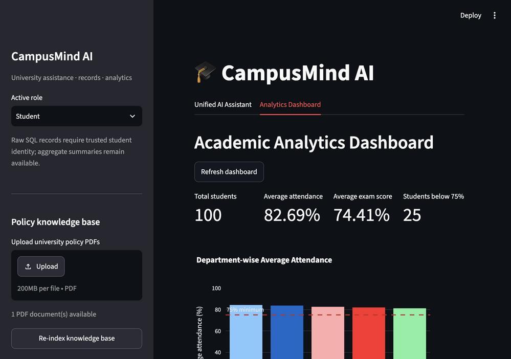
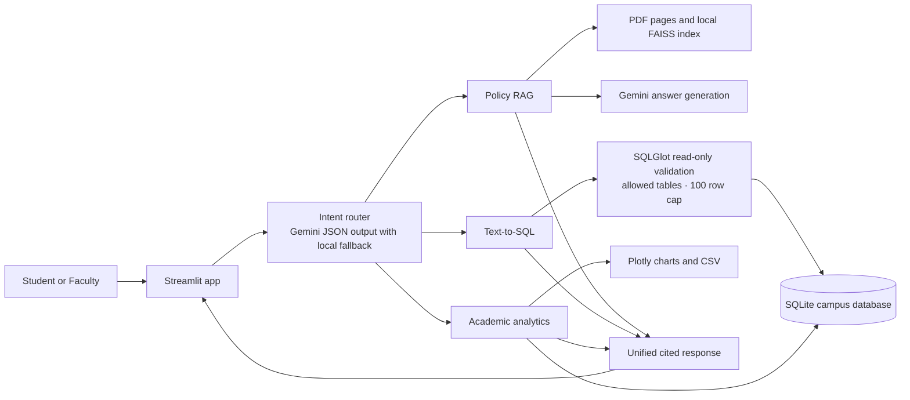

# CampusMind AI

**A university policy assistant, read-only academic data assistant, and analytics dashboard in one Streamlit app.**



CampusMind AI is a presentation-ready university intelligence demo built with Python. It includes a sample Indian university dataset and an academic handbook PDF, so you can explore the app locally without connecting a real student information system. Full Gemini-powered answers require a Gemini API key.

## What it does

| Capability | What you can do |
| --- | --- |
| Policy assistant (RAG) | Ask questions about uploaded university PDFs and receive page-level citations. |
| Database assistant (Text-to-SQL) | Ask questions about departments, students, courses, attendance, and exam results in natural language. |
| Academic analytics | Explore KPIs, department attendance, course score distributions, attendance/marks relationships, and a filtered low-attendance watchlist. |
| Compound questions | Ask for a combination of database results, policy guidance, and an analytics summary in one message. |

## Architecture



The PDF text extraction, chunking, embeddings, retrieval, SQLite storage, and SQL validation run locally. Gemini is used for intent routing and language generation when `GEMINI_API_KEY` is configured. Retrieved policy excerpts and prompts are sent to the Gemini API to generate answers; use synthetic or approved content for demonstrations.

## Run it locally

### 1. Get the code

The presentation repository is private. Sign in to GitHub and use GitHub CLI:

```bash
gh auth login
gh repo clone divyajyoti019/CampusMind-AI
cd CampusMind-AI
```

Or clone the repository over HTTPS using a Git credential manager:

```bash
git clone https://github.com/divyajyoti019/CampusMind-AI.git
cd CampusMind-AI
```

### 2. Create a Python environment and install dependencies

Python 3.10 or newer is required. The commands below work on macOS/Linux:

```bash
python3 -m venv .venv
source .venv/bin/activate
python -m pip install --upgrade pip
pip install -r requirements.txt
```

Windows PowerShell:

```powershell
py -m venv .venv
.venv\Scripts\Activate.ps1
python -m pip install --upgrade pip
pip install -r requirements.txt
```

### 3. Configure Gemini

Copy `.env.example` to `.env`, then replace the placeholder with your Gemini Developer API key:

```bash
cp .env.example .env
```

```dotenv
GEMINI_API_KEY=your_real_api_key
# Optional model override; the default is gemini-3.8-flash.
GEMINI_MODEL=gemini-3.8-flash
```

Keep `.env` private; it is excluded from Git. The UI can start without an API key, but full Gemini routing and answer generation will not be available.

### 4. Start the app

```bash
streamlit run app.py
```

Open **http://localhost:8501** in your browser. Streamlit prints the local address in the terminal as well. The GitHub repository stores the project source; it does not itself host a running app.

### 5. (Optional) Host it on Streamlit Community Cloud

1. Sign in at [share.streamlit.io](https://share.streamlit.io) with GitHub and click **Create app**.
2. Choose this repository, the branch, and `app.py` as the main file. Under **Advanced settings**, pick Python 3.12.
3. In **Secrets**, add `GEMINI_API_KEY = "your_real_api_key"` (and optionally `GEMINI_MODEL`).
4. Deploy. On the first start the app downloads the MiniLM embedding model and builds the policy index automatically; this takes about a minute.

Anyone with the app link uses your Gemini key, so set a usage limit or budget alert on it.

## How to use and manage the app

### Assistant and role selector

1. Choose **Student** or **Faculty / Administrator** in the sidebar.
2. Ask a question in the Unified AI Assistant tab, or select a sample prompt from the sidebar.
3. For a compound question, the router selects the relevant modules and the response shows routing badges, SQL results, policy citations, and/or an analytics chart.
4. Use the Analytics Dashboard tab for the university KPIs and interactive charts.

The sample database is synthetic and contains 5 departments, 20 courses, and 100 students. Twenty-five generated students have attendance below 75%, giving the watchlist useful demo data.

**Demo access note:** the role selector demonstrates application behavior; it is not a login system. Student SQL requests are constrained to permitted aggregate/self-scoped queries, and faculty mode exposes student-level records and CSV export. Because anyone using the demo can change the selector, do not connect real student records until you replace it with authenticated identities and server-side role checks.

### Upload policy PDFs and refresh the index

1. In the sidebar, upload one or more university policy PDFs.
2. Click **Re-index knowledge base** after adding or replacing documents.
3. Ask policy questions in the assistant. Supported answers include citations such as `[University_Academic_Handbook.pdf, Page 1]`.

Uploads are saved under `data/documents/`. The embedding model (`all-MiniLM-L6-v2`, run through FastEmbed/ONNX so PyTorch is not needed) is downloaded locally on first indexing. If no index exists when the app starts, it is built automatically from the PDFs in `data/documents/`. The generated FAISS index and chunk metadata are saved under `data/faiss_index/` and are excluded from Git; re-index after cloning or after changing PDFs.

### Database and watchlist

- The included `data/campusmind.db` is a deterministic synthetic dataset.
- If the database file is missing, the app creates and seeds it when it starts.
- To reset/regenerate all sample rows, activate the virtual environment and run:

  ```bash
  python -m database.sample_data
  ```

- Faculty / Administrator can filter the low-attendance watchlist by department, semester, and course, then download the current results as CSV.
- Analytics are calculated from the local SQLite database. The **Refresh dashboard** button recomputes the displayed summary and charts.

## Security and data boundaries

- Generated SQL is parsed with SQLGlot, must be a single `SELECT`, may reference only the CampusMind tables, and is capped at 100 rows.
- The Student role applies stricter academic-record query rules. The sidebar role is still demo-only and must not be treated as production authentication.
- Use synthetic or approved data for presentations. Do not commit `.env`, credentials, private university records, or confidential policy PDFs.
- `data/documents/` contains the sample handbook. Additional PDFs uploaded during a demo are local files; review them before committing or sharing the repository.
- The database, uploaded files, and FAISS index are local to the machine unless you deliberately deploy or synchronize them elsewhere.

## Tests and prompt evaluation

Run the automated tests:

```bash
python -m pytest tests -q
```

Run the deterministic 20-case evaluation without calling Gemini:

```bash
python tests/eval_prompts.py
```

With `GEMINI_API_KEY` configured, `--live` evaluates actual routing, SQL, and RAG calls. It can make multiple Gemini requests and may incur API usage:

```bash
python tests/eval_prompts.py --live
```

The offline evaluation checks routing labels, read-only SQL execution, and citation support against the bundled handbook. It does not measure a live language model's response quality.

## Project structure

```text
app.py                     Streamlit app, assistant chat, dashboard, and role switcher
config.py                  Settings, model name, and local data paths
database/
  schema.sql               SQLite schema and indexes
  db.py                    Database helpers and safe read-only query execution
  sample_data.py           Repeatable synthetic university data generator
modules/
  intent_router.py         Multi-intent routing and role-aware plans
  rag_assistant.py         PDF retrieval and cited answer generation
  text_to_sql.py           Gemini SQL generation and guarded execution
  analytics.py             KPIs, Plotly figures, watchlist, and AI summary
prompts/                   Separate prompts for each AI capability
utils/                     PDF parsing, embeddings, and SQL/RBAC guardrails
data/
  campusmind.db            Included synthetic SQLite sample database
  documents/               Sample and locally uploaded university PDFs
tests/                     Pytest suite and 20-case evaluation harness
assets/                    README preview image
```

## Updating your private GitHub repository

After editing files, review the changes, then commit and push:

```bash
git status
git add README.md .gitignore app.py config.py database modules prompts tests utils data assets requirements.txt .env.example
git commit -m "Prepare CampusMind AI presentation release"
git push origin main
```

Keep `.env` and private data out of commits. To get the latest project changes on another computer, run `git pull --ff-only` from the repository directory.
